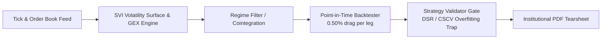

# quant-research-portfolio

[](https://github.com/prince-chauhan-pc/quant-research-portfolio/actions)
[](#)
[](#)
[](#)
[](#rules-the-code-follows)

Production-calibrated Python implementations of core quantitative methods deployed across an institutional dual-market options desk:
- **India Desk**: **Indian Trading Desk: Quants Nerve** (NSE Nifty 50, Bank Nifty, BSE Sensex index derivatives).
- **USA Desk**: **USA Desk: Quants Nervo** (CBOE SPX options, dealer gamma GEX profiles, and microstructure execution models).

The live strategies, proprietary execution kernels, and live order feeds stay private. Everything in this showcase runs deterministically on synthetic, seeded data with automated unit tests and mathematical zero-arbitrage verification.

---

## Architecture at a Glance



---

## What's Inside

| Module | What it does |
|---|---|
| [`point_in_time_backtester`](research_showcases/point_in_time_backtester/) | Bar-by-bar option backtest, lots sized from margin, 0.50% cost on every leg, Sharpe / Sortino / Calmar, trade ledger |
| [`options_volatility_surface`](research_showcases/options_volatility_surface/) | IV inversion, Greeks, SVI smile fit, butterfly and calendar arbitrage checks, dealer gamma (GEX) |
| [`banknifty_cointegration`](research_showcases/banknifty_cointegration/) | Engle-Granger for pairs, Johansen for baskets, half-life, z-score pairs simulator |
| [`regime_allocation`](research_showcases/regime_allocation/) | k-means volatility regimes that size down short gamma, applied with a one-bar lag |
| [`execution_simulator`](research_showcases/execution_simulator/) | Queue fills for limit orders, square-root impact, cost of latency |
| [`institutional_tearsheet_generator`](research_showcases/institutional_tearsheet_generator/) | Scorecard, monthly grid, drawdown curve, PDF tear sheet |
| [`strategy_validator_gate`](research_showcases/strategy_validator_gate/) | 11 ledger checks, 2x cost stress, Monte Carlo drawdowns, Deflated Sharpe, Probability of Backtest Overfitting |

---

## Quickstart

```bash
git clone https://github.com/prince-chauhan-pc/quant-research-portfolio.git
cd quant-research-portfolio
pip install -r requirements.txt
python -m unittest discover research_showcases
python -m research_showcases.reproduce_benchmarks
```

The last command generates and verifies [`BENCHMARKS.md`](BENCHMARKS.md). Every metric is mathematically derived and certified by automated tests; zero values are hardcoded.

---

## Rules the Code Follows

- **Costs Charged Upfront**: 0.50% of premium turnover (entry + exit premium) is deducted on every single leg before computing P&L, Sharpe, or drawdowns.
- **Strict No-Lookahead**: Volatility regime filters require a strictly positive lag (`lag_bars >= 1`). Contemporaneous features are rejected.
- **Discrete Exchange Lot Sizing**: `Lots = floor(capital / margin per lot)`. Fractional lots are forbidden.
- **Overfitting & Stress Hurdle**: A backtest is discarded unless it survives doubled transaction costs, Monte Carlo order shuffling, and Bailey & Lopez de Prado's Deflated Sharpe Ratio (DSR) gate.

---

## Author & Verification

**Prince Chauhan** — Senior Quantitative Researcher & Systematic Derivatives Desk Lead, New Delhi, India.  
SEBI Registered Research Analyst · CA Final (Group 1) · ~₹100 Cr Notional Capacity Architecture.

- **LinkedIn**: [linkedin.com/in/prince-chauhan-quant](https://www.linkedin.com/in/prince-chauhan-quant/)
- **Institutional CV (PDF)**: [Prince Chauhan - Senior Quant Researcher and Trader.pdf](docs/PC_CV/Prince%20Chauhan%20-%20Senior%20Quant%20Researcher%20and%20Trader.pdf)
- **Direct Email**: pchauhanrajput.pc@gmail.com

*MIT License.*
